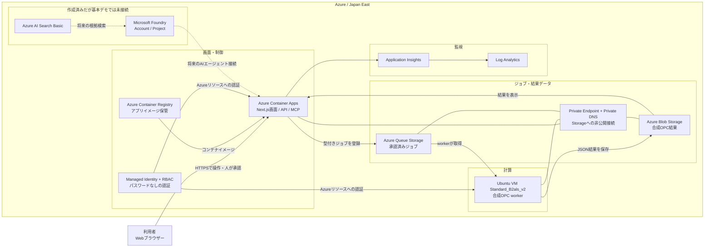
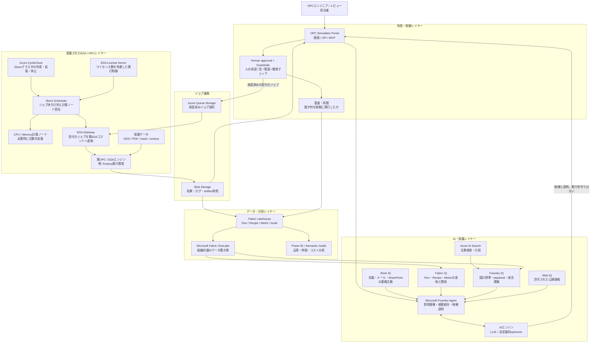

# OPC IQ Orchestrator

Synopsys製品、GDS、maskデータ、PDK、本番データを使わず、疑似Proteus互換契約でMicrosoft IQ、Foundry、Fabric、Azure HPC連携の運用像を実証するデモです。

## 実証範囲

- Work IQ / Fabric IQ / Foundry IQ / Web IQの出典付き根拠
- Human-in-the-loop承認後のみ開始するOPC Run
- `awaiting_approval -> queued -> running -> completed` の状態遷移
- EPE、PV Band、欠陥リスク、process window、実行時間、コストの比較
- Azure Queue Storageから小型Linux VMへ投入する実ジョブ契約
- SHA-256ハッシュチェーンによる監査ログと改ざん検知
- Foundry project、AI Search、Fabric Lakehouse接続点、MCPエンドポイント

接続情報がない場合はIQ根拠が明示的な合成データへフォールバックします。MCP、承認、Runner状態遷移、OPC評価、監査チェーン、疑似Proteus CLIは実際に動作します。

## システム構成

ここでは、現在のデモで実際に動いている構成と、実プロダクションで想定する構成を分けて示します。**現在のデモでは実線部分が動作し、点線部分はリソースまたは接続口だけを用意しています。**

### 1. 現在のデモ環境

現在のデモは、すべてAzure上で動作します。OPC計算そのものはライセンス不要の合成workerが小型Linux VM上で実行し、実Proteus、実GDS、PDK、maskデータは使用しません。



現在の処理は次の順番です。

1. 利用者がContainer Apps上のWeb画面で候補と根拠を確認します。
2. 利用者が `設計条件を承認` を選ぶと、アプリが決められた形式のジョブだけをQueue Storageへ登録します。
3. Linux VMの合成workerがQueueからジョブを取得して計算します。
4. workerが結果をBlob Storageへ保存し、Web画面が取得して比較表示します。
5. 承認、実行、結果のイベントはSHA-256ハッシュチェーン付き監査ログとして画面に表示されます。

StorageはPublic Network Accessを無効にし、Container AppsとVMからPrivate Endpoint経由で接続します。アプリとVMはManaged Identityで認証するため、Storageアクセスキーをコードや設定ファイルに保存しません。

> **現在のデモに含まれないもの:** Microsoft Fabric F SKU、OneLake/Lakehouse、実Work IQ、実Fabric IQ、Foundryのモデルデプロイ、実Proteus、CycleCloud、Slurmクラスタは展開していません。画面上のIQ根拠とOPC結果は合成データです。

### 2. プロダクション利用時の想定構成

プロダクションでは、小型VMの合成workerを、Azure CycleCloudから展開したSlurmクラスタと実EDA実行ゲートウェイに置き換えます。Foundry、Fabric、各IQ、AIエンジンは、候補作成と説明を支援しますが、**AIが直接シェルコマンドやEDAツールを実行することはありません。** 人の承認、入力スキーマ検証、許可範囲チェックを通過したジョブだけをHPCへ送ります。



本番での役割分担は次のとおりです。

1. **知る:** 各IQとAI Searchが、利用者に許可された業務情報、過去Run、設計標準、公開情報を探します。
2. **考える:** Foundry AgentとAIエンジンが根拠をまとめ、制約内の候補パラメータと比較理由を作ります。
3. **決める:** エンジニアが根拠、予測効果、コスト、データ境界を確認して承認します。
4. **実行する:** 承認済みの型付きジョブだけをQueueへ登録し、EDA GatewayがSlurm上の実EDA処理へ変換します。
5. **蓄積する:** 結果と監査情報をBlobおよびFabric Lakehouseへ保存します。
6. **改善する:** Fabricに蓄積した履歴をFabric IQやFoundry IQの次回の根拠として再利用します。

CycleCloudはSlurm自体ではなく、Azure上にSlurmクラスタを作成し、需要に応じて計算ノードを増減・停止するための管理サービスです。Slurmは投入された多数の計算ジョブを待ち行列に入れ、空いている計算ノードとEDAライセンスへ割り当てます。

GDS、PDK、mask、contour、ライセンス情報は保護されたEDA/HPCレイヤー内に置き、LLM、Web検索、プロンプトへ送信しません。AIへ渡すのは、匿名化または集約した指標、許可済み文書、型定義されたパラメータです。

### 初心者向け用語解説

| 用語 | この構成での意味 |
| --- | --- |
| Microsoft Foundry | AIアプリやAIエージェントを作り、モデル、ツール、知識検索、評価、監視をまとめて管理する場所です。この構成では「根拠を集めて候補を説明する司令塔」に相当します。 |
| Foundry Agent | 利用者の質問を理解し、許可された検索やツールを呼び出して回答・候補を作るAIアプリです。EDAコマンドを直接実行する権限は持たせません。 |
| AIエンジン | LLMだけではなく、候補生成、数値最適化、ルール判定、ランキングを組み合わせた総称です。文章の説明はLLM、範囲チェックやOPC Scoreは決定論的コードが担当します。 |
| Azure AI Search | 設計標準や過去レポートを検索し、回答に引用元を付けるための検索サービスです。LLMが記憶だけで回答することを避けます。 |
| Microsoft Fabric | データ取込、保存、加工、分析、可視化を一つにまとめたデータ分析基盤です。OPCのRun、Recipe、Metric、Approval、Auditを長期的に管理します。 |
| OneLake | Fabricで共通利用する組織内データレイクです。複数チームが同じ管理されたデータを再利用できます。 |
| Lakehouse | データレイクの柔軟性と、表形式で分析しやすいデータウェアハウスの特性を組み合わせた保存・分析方式です。 |
| IQ | AIが判断するときに使う「権限付きの文脈・知識・関係性」を提供する考え方です。IQは1つの巨大AIモデルではなく、目的別の情報源とアクセス方法です。 |
| Work IQ | Microsoft 365の会議、メール、ファイル、担当者などから、現在の業務意図を利用者権限の範囲で提供します。 |
| Fabric IQ | Fabric内のデータに、Design、Recipe、Run、Metricなどの意味と関係を持たせ、AIが業務用語で理解できるようにします。 |
| Foundry IQ | Foundryから設計標準、playbook、過去実験などの管理された知識を検索し、引用付きでAIへ渡します。 |
| Web IQ | 許可された公開Web情報を根拠として利用します。設計IDや機密OPC値は検索へ渡しません。 |
| MCP | AIエージェントが外部ツールやデータを決められた形式で呼び出すための共通インターフェースです。 |
| Azure CycleCloud | Azure上のHPCクラスタをテンプレートから作成し、計算需要に応じてノードを増減・停止する管理サービスです。 |
| Slurm | HPCで広く使われるジョブスケジューラです。多数の計算ジョブを管理し、利用可能な計算ノードへ割り当てます。 |
| Human-in-the-loop | AIの提案をそのまま実行せず、人が根拠と条件を確認して承認する仕組みです。 |

本番構成図は想定アーキテクチャであり、現在のBicepがすべてを展開するわけではありません。実導入時は、Fabric容量とTenant設定、Foundryモデルとクォータ、Microsoft 365権限、CycleCloud/Slurmテンプレート、EDAライセンス、閉域ネットワーク、データ所在地、監査要件を個別に設計・承認します。

## ローカル起動

```bash
npm ci
npm run dev
```

ブラウザで `http://localhost:3000` を開きます。

## デモ手順

所要時間は12〜15分です。現在の展開済み環境は [OPC IQ Orchestrator](https://azcavwmywb6ahsies.bravesand-7d11e148.japaneast.azurecontainerapps.io/) から開けます。このURLはAzure上のContainer Appから取得し、2026年10月13日にHTTP 200でアクセスできることを確認しています。新しく展開した場合のURLは [展開後のURL確認](#展開後のurl確認) を参照し、ローカル環境では `http://localhost:3000` を使用してください。

### 1. デモの目的を説明する（1分）

画面右上の `DEMO / JAPAN EAST` と、ベースラインの `94 min / run` を示します。

> OPC条件の探索では、EPEやprocess windowを改善するために多数のシミュレーションが必要です。このデモでは、複数のIQから候補を絞り、人が承認した処理だけをAzure上の疑似Proteus workerへ投入します。

### 2. IQの根拠と保護境界を確認する（2分）

上部の4つのIQカードと、右側の `Grounding evidence` を説明します。

- `Work IQ`: 会議、メール、担当者の意図
- `Fabric IQ`: 過去Run、Recipe、process window
- `Foundry IQ`: OPC標準、過去実験、設計ガイド
- `Web IQ`: 承認された公開情報

`Protected compute boundary` では、GDS、PDK、mask contour、ライセンス情報をLLMやWeb検索へ送らない設計であることを示します。現在のデモのIQ根拠は合成データであり、Fabric F SKU、実OneLake、実業務データには接続していません。

### 3. Human approvalからAzure実行までを見せる（3分）

1. `Run control` の `Campaign launch approval` で、候補のstrategy、risk、根拠を確認します。
2. 候補の `設計条件を承認` を選択します。
3. 状態が `承認待ち -> Queue投入済み -> 実行中 -> 完了` と変化することを確認します。
4. 結果欄にEPE p95、PV Band、OPC Scoreが表示されることを確認します。

承認後は、型付けされたジョブがAzure Queue Storageへ登録されます。Managed Identityを持つLinux VMがジョブを取得し、結果をBlob Storageへ保存します。Queue、Blob、VM、Container Apps間の通信にはVNetとPrivate Linkを使用します。

### 4. OPC候補を比較する（2分）

`OPC comparison` タブを開き、Baselineと完了済み候補を比較します。

- EPE p95、PV Band、defect riskは小さいほど良い
- Process windowは大きいほど良い
- Runtimeとcompute costも含めて評価する
- `OPC Score` と `推奨` は複数指標を統合した意思決定支援であり、単純な最速候補の選択ではない

表示される性能値とコストはデモ用の合成結果です。実Proteusのベンチマーク結果や性能保証として説明しないでください。

展開済み環境の `RUN-0101` では、EPE p95 `2.25 nm`、PV Band `7.58 nm`、defect risk `272 ppm`、process window `88.3`、runtime `71 min`、compute cost `$0.142` が確認用の合成結果です。

### 5. 最終承認と次世代探索を実行する（3分）

1. `Run control` に戻り、`Final Approval` で完了済みの推奨候補を確認します。
2. 候補の `最終承認` を選択し、承認者と日時が記録されることを確認します。
3. `次の探索を作成` を選択します。
4. 親候補、EPE上限、PV Band上限、process window下限、fragment上限、候補数を確認または変更します。
5. `Campaignを作成` を選択し、`GEN 2` の候補が生成されることを確認します。

承認済み候補を親として局所探索することで、全組み合わせを毎回試すのではなく、価値の低いシミュレーションを避けるAdaptive explorationを表現します。

### 6. 監査証跡を確認する（1分）

`Audit trail` タブを開き、承認、開始、完了、最終承認、親候補選択、パラメータ変更のイベントを確認します。各イベントにはactor、対象、時刻、直前イベントのSHA-256ハッシュが記録されます。右上の `Chain verified` が監査チェーンの整合性を示します。

### 7. MCPと本番拡張を説明する（1分）

右上のネットワークアイコン、または `/api/mcp` を開きます。同じRun情報と監査情報をMCP経由でCopilotやエージェントから利用できます。

> 現在は小型VM 1台で合成workerを動かしています。本番ではQueue契約を維持したまま、実Proteus実行ラッパー、CycleCloud Slurm、または既存オンプレミスHPCへ接続できます。Azureの価値は、必要時の並列拡張と、根拠・承認・結果を一つの監査チェーンで管理できる点にあります。

### デモの再実行

右上のリセットボタンは画面状態と監査状態を初期化しますが、Blob Storage上の過去結果は削除しません。同じRun IDの結果Blobが残っていると、再承認時に過去結果が直ちに反映される場合があります。状態遷移をライブで再演する場合は、事前に `opc-results` コンテナーの対象 `runs/<run-id>/result.json` を退避または削除してください。

デモ中は、実Proteus性能を計測したものではないこと、IQの権限を迂回しないこと、小型VM 1台は本番OPC処理能力を表現しないことを明示します。詳細な話法と避けるべき主張は [デモ台本](docs/demo-runbook.md) を参照してください。

## MCP tools

| Tool | 用途 |
| --- | --- |
| `list_design_runs` | 候補と現在状態の一覧 |
| `approve_design_run` | Human approvalの記録とキュー投入 |
| `compare_completed_runs` | 完了RunのOPC比較 |
| `read_audit_log` | 監査イベントとチェーン検証 |

## Azure展開

前提はAzure CLI、Docker、対象サブスクリプションへのContributor以上の権限、RBAC割当権限です。リージョン、VM SKU、Foundryモデル、クォータは展開直前に対象サブスクリプションで確認してください。

```bash
az login
chmod +x scripts/deploy-azure.sh
AZURE_TENANT_ID=<tenant-id> \
AZURE_SUBSCRIPTION_ID=<subscription-id> \
RESOURCE_GROUP=rg-eda-opc-iq-demo \
LOCATION=japaneast \
FOUNDRY_LOCATION=japaneast \
VM_SIZE=Standard_B2als_v2 \
./scripts/deploy-azure.sh
```

BicepはACR、Container Apps、Storage Queue/Blob、VNet、public IPなしのUbuntu VM、Foundry project、AI Search、managed identity、RBAC、Log Analytics、Application Insightsを作成します。Storage shared keyとACR管理者資格情報は無効です。

詳細は [アーキテクチャ](docs/architecture.md)、[デモ台本](docs/demo-runbook.md)、[サービス接続](docs/service-connections.md)、[デプロイ計画](.azure/deployment-plan.md) を参照してください。

### 展開後のURL確認

OPC IQ OrchestratorのURLは、Azure Container Appの「アプリケーションURL」です。新しく展開したり環境を再作成したりするとURLが変わる場合があるため、上記の固定リンクではなく、今回展開したContainer Appから確認してください。デプロイスクリプトが最後に表示する `Application: https://...` も同じURLです。

**Azure Portalで確認する場合**

1. [Azure Portal](https://portal.azure.com/) にサインインします。
2. 「リソース グループ」から展開先の `rg-eda-opc-iq-demo` を開きます。別の名前で展開した場合は、そのリソースグループを選択します。
3. リソース一覧で、種類が「Container App」のリソースを開きます。「Container Apps Environment」や「Container Registry」ではありません。
4. 「概要」に表示される「アプリケーションURL」をクリックするか、コピーしてブラウザで開きます。

**Azure CLIで確認する場合**

まず、展開先のサブスクリプションを選択し、Container Appの名前とホスト名（FQDN）を取得します。`<subscription-id>` とリソースグループ名は展開時の値に置き換えてください。

```bash
az account set --subscription "<subscription-id>"
RESOURCE_GROUP="rg-eda-opc-iq-demo"
az containerapp list --resource-group "$RESOURCE_GROUP" \
  --query "[].{Name:name,FQDN:properties.configuration.ingress.fqdn}" \
  --output table
```

表示された `Name` を次の `APP_NAME` に設定すると、URLの取得とHTTPアクセス確認ができます。

```bash
APP_NAME="<一覧に表示されたContainer Appの名前>"
FQDN="$(az containerapp show --resource-group "$RESOURCE_GROUP" --name "$APP_NAME" \
  --query properties.configuration.ingress.fqdn --output tsv)"
APP_URL="https://$FQDN"
printf 'Application: %s\n' "$APP_URL"
curl --silent --show-error --location --max-time 60 \
  --output /dev/null --write-out 'HTTP %{http_code}\n' "$APP_URL"
```

`HTTP 200` と表示されれば、アプリケーションのトップページにアクセスできています。表示された `Application` のURLをブラウザで開いてください。HTTP 200以外や接続エラーの場合は、デプロイ完了とContainer Appの状態・ログを確認してください。HTTP 200はトップページの応答確認であり、workerや各外部サービスの動作確認とは別です。

## 利用サービスと課金範囲

デモの実行基盤はAzureだけです。Azure Container Apps、Azure Container Registry Basic、Azure Linux VM `Standard_B2als_v2`、Azure Queue/Blob Storage、VNet、NSG、Private Endpoint、Private DNS、Microsoft Foundry Account/Project、Azure AI Search Basic、Application Insights、Log Analytics、Managed Identity、Azure RBACを使用します。

次のサービスや製品は現在の基本デモでは使用しません。

- Synopsys Proteus、実EDAライセンス、実GDS、PDK、mask、contourデータ
- Microsoft Fabric F SKU、実OneLake、実Lakehouse
- 実Work IQ、実Fabric IQ、Foundryのモデルデプロイと生成AI推論
- Azure Bastion、Azure Firewall、Public IP

画面上のWork IQ、Fabric IQ、Foundry IQ、Web IQは、接続情報がない場合に合成根拠を使用します。GitHub、Docker、Azure CLIは開発・展開ツールであり、デモ実行時のクラウド基盤ではありません。

## デモ終了後のコスト管理

### 後日再利用するため一時停止する場合

対象Subscriptionを明示し、タグからVMとContainer Appの名前を取得します。

```bash
SUBSCRIPTION_ID="<subscription-id>"
RESOURCE_GROUP="rg-eda-opc-iq-demo"

az account set --subscription "$SUBSCRIPTION_ID"
az account show \
	--query "{Subscription:name, SubscriptionId:id, TenantId:tenantId}" \
	--output table

VM_NAME=$(az vm list \
	--resource-group "$RESOURCE_GROUP" \
	--query "[?tags.application=='eda-iq-demo'].name | [0]" \
	--output tsv)

APP_NAME=$(az containerapp list \
	--resource-group "$RESOURCE_GROUP" \
	--query "[?tags.application=='eda-iq-demo'].name | [0]" \
	--output tsv)
```

VMを停止ではなく割り当て解除し、Container Appも停止します。

```bash
az vm deallocate \
	--resource-group "$RESOURCE_GROUP" \
	--name "$VM_NAME"

az containerapp stop \
	--resource-group "$RESOURCE_GROUP" \
	--name "$APP_NAME"
```

VMが `VM deallocated` になったことを確認します。

```bash
az vm get-instance-view \
	--resource-group "$RESOURCE_GROUP" \
	--name "$VM_NAME" \
	--query "instanceView.statuses[?starts_with(code,'PowerState/')].displayStatus" \
	--output tsv
```

一時停止後も、VM OS Disk、Azure AI Search Basic、ACR Basic、Storage容量、Private Endpoint、保存済みログなどの課金は残ります。BastionとAzure Firewallはテンプレートで作成していないため、停止や削除は不要です。

### 長期間使わないため完全削除する場合

課金を最小化する最も確実な方法は、デモ専用Resource Group全体の削除です。削除すると、Storage上の結果、監査データ、ACRイメージ、VMディスクを含むデモ環境が失われます。必要なデータは事前に退避してください。

```bash
SUBSCRIPTION_ID="<subscription-id>"
RESOURCE_GROUP="rg-eda-opc-iq-demo"

az account set --subscription "$SUBSCRIPTION_ID"

az resource list \
	--resource-group "$RESOURCE_GROUP" \
	--query "[].{Name:name, Type:type, Location:location}" \
	--output table

az group delete \
	--name "$RESOURCE_GROUP" \
	--subscription "$SUBSCRIPTION_ID" \
	--yes \
	--no-wait
```

削除は非同期です。次の結果が `false` になるまで、再展開を開始しないでください。

```bash
az group exists \
	--name "$RESOURCE_GROUP" \
	--subscription "$SUBSCRIPTION_ID"
```

## デモ環境の再開と再展開

### 一時停止した環境を再開する場合

```bash
az vm start \
	--resource-group "$RESOURCE_GROUP" \
	--name "$VM_NAME"

az containerapp start \
	--resource-group "$RESOURCE_GROUP" \
	--name "$APP_NAME"

az vm run-command invoke \
	--resource-group "$RESOURCE_GROUP" \
	--name "$VM_NAME" \
	--command-id RunShellScript \
	--scripts "systemctl is-active opc-worker" \
	--query "value[0].message" \
	--output tsv
```

`opc-worker` が `active` になれば実行可能です。画面右上のリセットボタン、または `POST /api/demo/reset` でデモ状態を初期化します。過去結果Blobを残したまま同じRun IDを承認すると、その結果が直ちに反映される場合があります。ライブの状態遷移を再演する場合は「デモの再実行」の手順に従って対象Blobも削除してください。

### Resource Groupを削除した後に再展開する場合

同じTenant、Subscription、Resource Group名、リージョンを指定してデプロイスクリプトを再実行します。

```bash
cd /home/hikurais/eda-iq-demo

AZURE_TENANT_ID="<tenant-id>" \
AZURE_SUBSCRIPTION_ID="<subscription-id>" \
RESOURCE_GROUP="rg-eda-opc-iq-demo" \
LOCATION="japaneast" \
FOUNDRY_LOCATION="japaneast" \
./scripts/deploy-azure.sh
```

スクリプトはResource Group作成、Bicep validation、what-if、Azureリソース展開、ACR Build、Container App更新、VM worker確認を実行し、最後に新しいApplication URLとMCP URLを表示します。

同じSubscriptionとResource Group名では決定論的なリソース名が再利用されますが、Container AppsのFQDNは再作成時に変わる可能性があります。以前のURLを固定値として使わず、スクリプトが最後に表示するURLを使用してください。削除直後はリソース名の解放や削除処理に時間がかかる場合がありますが、2週間後の再展開であれば通常は問題ありません。

再展開前に次を確認します。

- Resource Groupの削除が完了し、`az group exists` が `false` である
- Azure CLIが対象TenantとSubscriptionにログインしている
- Japan EastでVM、Container Apps、Azure AI Search、Microsoft Foundryを利用できる
- `Standard_B2als_v2`のクォータと各サービスのSKU可用性に変更がない
- 対象SubscriptionのAzure PolicyとResource Provider登録に変更がない
- ローカルのソースコード、Dockerfile、Bicep、workerスクリプトが保管されている

## 別のAzure Subscriptionへの展開

対象SubscriptionではResource Groupと各リソースを作成する権限に加え、Managed IdentityへRBACを割り当てる権限が必要です。簡単にはSubscriptionまたはResource GroupスコープのOwner、またはContributorとUser Access Administratorの組み合わせを使用します。

対象TenantとSubscriptionへログインし、選択内容を確認します。

```bash
az login --tenant "<target-tenant-id>"

az account set --subscription "<target-subscription-id>"

az account show \
	--query "{Name:name, SubscriptionId:id, TenantId:tenantId, User:user.name}" \
	--output table
```

Conditional Accessが有効なTenantでは、準拠済みWindows端末のAzure CLIとWAMによるログインが必要になる場合があります。

必要なResource Providerを登録します。

```bash
for provider in \
	Microsoft.App \
	Microsoft.ContainerRegistry \
	Microsoft.Storage \
	Microsoft.Network \
	Microsoft.Compute \
	Microsoft.ManagedIdentity \
	Microsoft.OperationalInsights \
	Microsoft.Insights \
	Microsoft.CognitiveServices \
	Microsoft.Search \
	Microsoft.Authorization
do
	az provider register \
		--namespace "$provider" \
		--subscription "<target-subscription-id>"
done
```

別Subscriptionの値を必ず明示して展開します。スクリプトには現在のデモ環境向け既定値があるため、`AZURE_TENANT_ID`と`AZURE_SUBSCRIPTION_ID`を省略しないでください。

```bash
cd /home/hikurais/eda-iq-demo

AZURE_TENANT_ID="<target-tenant-id>" \
AZURE_SUBSCRIPTION_ID="<target-subscription-id>" \
RESOURCE_GROUP="rg-eda-opc-iq-demo" \
LOCATION="japaneast" \
FOUNDRY_LOCATION="japaneast" \
./scripts/deploy-azure.sh
```

展開前に対象SubscriptionでVMクォータ、AI Search Basic、FoundryのJapan East可用性、Azure Policy、RBAC権限を確認してください。Fabric F SKUは作成されず、合成IQを使う基本デモはFabricライセンスなしで動作します。

## 実サービスへの差し替え

- Work IQ: Work IQ API/MCPで会議、メール、SharePointの業務文脈をuser-scopedで取得
- Fabric IQ: OneLakeとontologyでDesign、Layer、Recipe、Run、Metric、Approvalを意味モデル化
- Foundry IQ: Azure AI Search knowledge baseとagentic retrievalで設計標準や過去DRを検索
- Web IQ: Grounding with Bing Search等で許可済み公開情報のみ検索
- EDA Gateway: 疑似RunnerをProteus実行ラッパー、CycleCloud、Slurm/LSF/Grid Engineへ置換

GDS、mask、PDK、contour、ライセンスキーをLLMへ送信せず、Web検索には設計IDやOPC値を渡さない境界を維持します。
